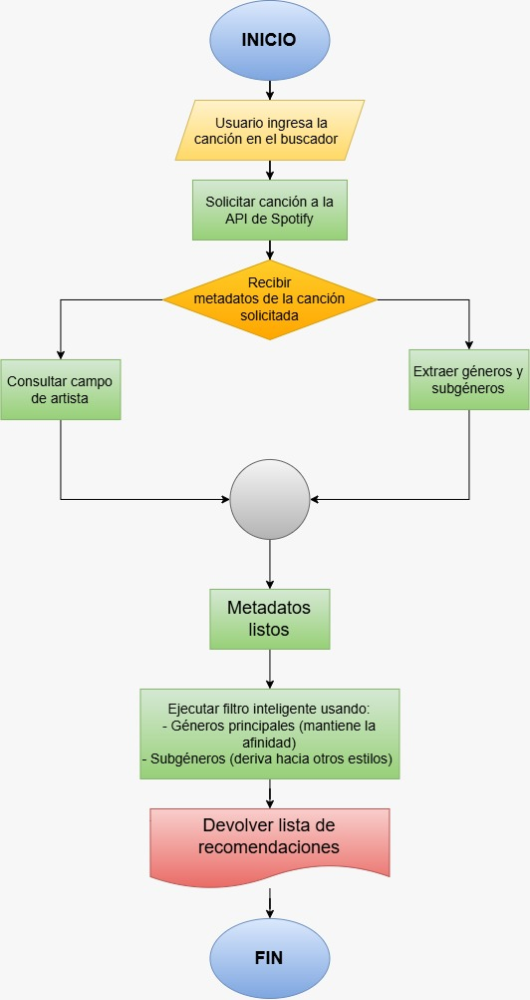
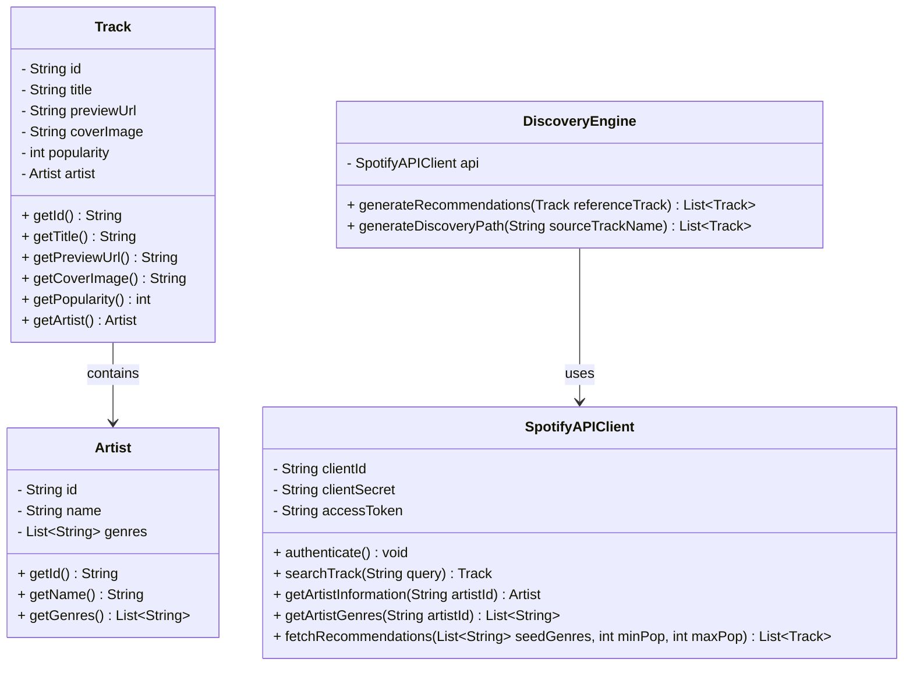

# Audy Project Documentation

## AUDY Video-Presentation

## Introduction

Audy is an online web tool designed to help users find and discover new music based on songs and artists they listen to and know they enjoy.

The user will be able to add a song as a reference, and the system will use that song to generate different suggestions for songs and artists that will suit similar tastes. Some songs will have characteristics akin to the original song, whether that is style, genre, artist or other relevant factors.

The system, however, will not be limited to only finding songs that sound alike. The inputted song will also function as a reference point to explore connections between genres, subgenres, musical styles and more relationships that will expand and diversify the user's musical catalog.

In this way, the recommendations made by the system will start from music relatively close to the original and slowly develop to include other music that might interest the user.

The primary objective is that the user can find artists or genres that they might not have listened to before and may not be able to find with a traditional search.

Unlike conventional systems that will give generic, obsolete, or repetitive suggestions, our system prioritizes the exploration and discovery of new and enjoyable music.

The system will try to avoid recommendations that are too mainstream or based solely on popularity, without reaching the point of suggesting artists with a nonexistent listening audience.

Therefore, the purpose of AUDY will be to ultimately help the user discover songs that match their affinity the most in a progressive and effective manner.

## Primary Objective

Develop a tool for music discovery that allows usage of a song known and liked by the user as a reference for obtaining recommendations for not just similar songs, but also genres, subgenres, artists and other suggestions that the user might enjoy.

This is done with the main objective of providing the user with a way to explore the music space in a way that they might not otherwise be able to.

## Functional Requirements

### RF-01: Search for a song
The system must allow the user to search up the song via a search browser.

### RF-02: Send API request
The system must send an API request to Spotify’s API based on the song provided by the user.

### RF-03: Receive song metadata
The system must receive the metadata of the requested song.

### RF-04: Utilize artist data
The system must utilize the "Artist" data for its operations.

### RF-05: Acquire genres and subgenres
The system must acquire the genres and subgenres linked to the artist of the song.

### RF-06: Apply popularity filter
The system must utilize the "popularity" data of the solicited song to utilize an adapted popularity filter.

### RF-07: Filter and find similar songs
The system must filter and find similar songs utilizing the parameters outlined, these being genre, subgenre, artist and popularity filter.

### RF-08: Return recommendations
The system must return the list of songs found to the user as a recommendation.

## Preliminary System Flow

The following diagram represents a preliminary version of how the system is expected to operate. The specific details of the process may change during the development phase.

## Preliminary Abstraction of Possible Classes

The following classes represent a preliminary abstraction of the main objects and components that could be part of the system. Since the project is currently in an initial design phase, their attributes, methods and relationships may change during development.

Most musical data will be obtained through external services, such as the Spotify Web API or LastFM API. The structures received from these services could be transformed into objects within our own system, allowing the application to work only with the information required for its operation.

### Class: Track

**Responsibility:**  
Represents a song within the system.

The class will store only the information about a song that is relevant for search and discovery functions.

**Attributes:**

- id
- title
- artist
- popularity
- previewUrl

**Methods:**

- getId()
- getTitle()
- getArtist()
- getPopularity()
- getCoverImage()
- getPreviewUrl()

### Class: Artist

**Responsibility:**  
Represents an artist and the musical information associated with them that can be used during the discovery process.

**Attributes:**

- id
- name
- genres

**Methods:**

- getId()
- getName()
- getGenres()

### Class: SpotifyAPIClient

**Responsibility:**  
Manages communication between the application and the Spotify Web API.

This class acts as an intermediary between the services provided by Spotify and the rest of the system.

**Methods:**

- authenticate()
- searchTrack()
- getArtistInformation()
- getArtistGenres()

Depending on the evolution of the project, additional methods may be added or modified according to the information that can actually be obtained through external APIs.

### Class: DiscoveryEngine

**Responsibility:**  
Manages the main logic of the music discovery process.

This class will use the information obtained from the reference song and other available sources to generate recommendations. The process may include both songs similar to the reference and songs obtained through the exploration of genres, subgenres, artists and other musical relationships.

**Methods:**

- generateRecommendations()
- generateDiscoveryPath()

Its function will not be limited to finding similar songs, but rather determining possible exploration paths that allow the user's musical catalog to progressively expand.

The Spotify Web API will initially be considered a source of musical information. The discovery and recommendation logic of the project will remain separated from communication with that API through SpotifyAPIClient.

## UML Class Diagram

The following diagram illustrates the relationships and structure of the preliminary classes defined above.

# Matriz de Trazabilidad: Requisitos vs Diseño

## Requerimientos Funcionales

| Requerimiento | Componentes | Cobertura | Estado |
| :--- | :--- | :--- | :--- |
| **RF-01** | Ninguno | Sin cobertura | Pendiente UI |
| **RF-02** | DiscoveryEngine, SpotifyAPIClient | Backend | En desarrollo |
| **RF-03** | DiscoveryEngine, SpotifyAPIClient | Backend | En desarrollo |
| **RF-04** | Track | Parcial | Pendiente UI |
| **RF-05** | Track, SpotifyAPIClient | Cubierta | En desarrollo |
| **RF-06** | Artist, SpotifyAPIClient | Cubierta | En desarrollo |
| **RF-07** | DiscoveryEngine, SpotifyAPIClient | Cubierta | En desarrollo |
| **RF-08** | Ninguno | Sin cobertura | Pendiente UI |
| **RF-09** | Track | Parcial | Pendiente UI |
| **RF-10** | Ninguno | Sin cobertura | Pendiente UI |
| **RF-11** | APIClientException | Parcial | Pendiente UI |

## Requerimientos No Funcionales

| Requerimiento | Componentes | Cobertura | Estado |
| :--- | :--- | :--- | :--- |
| **RNF-01** | Ninguno | Sin cobertura | Pruebas |
| **RNF-02** | APIClientException | Parcial | Pendiente UI |
| **RNF-03** | DiscoveryEngine | Backend | En desarrollo |
| **RNF-04** | DiscoveryEngine | Cubierta | En desarrollo |
| **RNF-05** | Clases APIClient | Cubierta | Implementado |

## Explicaciones y análisis de los Requerimientos cubiertos

### Requerimientos cubiertos por el backend
Los requerimientos de obtención de datos (RF-05, RF-06) se atienden mediante las propiedades de `Track` y `Artist` junto con las llamadas en `SpotifyAPIClient`. La lógica de búsqueda predictiva y filtrado (RF-02, RF-03, RF-07) recae en los métodos de `DiscoveryEngine`. El RNF-04 está garantizado por el atributo `lastKeystrokeTimestamp` que controla el tiempo de tipeo, y el RNF-05 se cumple al modularizar los clientes en `SpotifyAPIClient` y `MusicBrainzAPIClient`.

### Requerimientos con cobertura parcial
El modelo de datos soporta el RF-04 y RF-09 almacenando la información necesaria en la clase `Track` (como `previewUrl` y `playerUrl`), pero falta la capa de presentación. De igual forma, los errores de conexión (RF-11, RNF-02) son atrapados lógicamente por `APIClientException`, pero carecen de un controlador que muestre las alertas al usuario. El RNF-03 requerirá validaciones específicas dentro de `generateRecommendations` que no se reflejan directamente como atributos estructurales.

### Requerimientos sin cobertura
El diseño actual omite por completo los componentes visuales e interactivos. El RF-01 (campo de búsqueda), RF-08 (mostrar lista de recomendaciones) y RF-10 (avisos de resultados vacíos y retorno al inicio) no tienen clases asignadas en el patrón MVC. El RNF-01 sobre tiempos de respuesta dependerá de la implementación de red y no se modela en el UML estático.

## Interaction Flow and Interface Design

[View AUDY's Interaction Flow, Original Sketches, and Interface Design](diseno/README.md)

# Bitácora del Sprint y Seguimiento

**Duración del Sprint:** 1 Mes (4 Semanas)  
**Equipo de Trabajo (6 integrantes):**
1. Antochiw Flores Andrés
2. Couoh Mis Guillermo Moises
3. Gil Juárez Joshua Nabil
4. Jiménez Hernandez Xicoténcatl
5. Medina Uitz Eleazar
6. Thibault Raphael Didier Alexandre

---

## Semana 1: Refinamiento de Requisitos y Diseño de Flujo

**Fechas:** 06 de octubre al 10 de octubre  
**Objetivo de la semana:** Actualizar los requerimientos funcionales y no funcionales y comenzar el diseño de interfaces y casos de uso.

| Actividad | Responsable(s) | Estado | Resultados / Enlaces |
| :--- | :--- | :--- | :--- |
| Refinar RF y agregar RNF. | Guillermo | Completado | Enlace al PDF de RF y RNF |
| Diseñar flujo en Figma (búsqueda predictiva, errores). | Joshua | Completado | Enlace a Figma |
| Redactar historias de usuario basadas en RF-01 al RF-11. | Eleazar | Completado | Enlace al doc de Historias |
| Crear el formato de bitácora. | Xicoténcatl | Completado | Enlace al Tablero GitHub |

* **Reuniones y Acuerdos:**
  * Reunión de inicio (martes): Se acordó fusionar antiguos RF-4/RF-5 en el nuevo RF-06.
  * Se decidió usar SpotifyAPI y MusicBrainzAPI.
* **Problemas Encontrados:** Dudas sobre cómo medir el tiempo de respuesta del predictivo (RNF-04). Se resolvió investigando sobre `lastKeystrokeTimestamp`.

---

## Semana 2: Arquitectura y Modelado UML

**Fechas:** 12 de octubre al 17 de octubre  
**Objetivo de la semana:** Consolidar la arquitectura MVC parcial y refinar el diagrama de clases.

| Actividad | Responsable(s) | Estado | Resultados / Enlaces |
| :--- | :--- | :--- | :--- |
| Definir clientes de API y manejo de excepciones. | Alexandre, Andrés | Completado | Enlace a rama de código |
| Crear diagrama de clases UML (Mermaid). | Alexandre | Completado | Enlace al archivo MD del UML |
| Finalizar mockups de la vista de resultados. | Joshua | Completado | Enlace a Figma |
| Organizar rama de segunda entrega y el índice MD. | Joshua, Xicoténcatl | En progreso | Enlace al repositorio |

* **Reuniones y Acuerdos:**
  * Reunión de sincronización (jueves): Se acordó la estructura de `APIClientException` para manejar errores (RF-11).
* **Problemas Encontrados:** El UML original no contemplaba el patrón MVC para la interfaz (faltan Controladores y Vistas). Queda pendiente para revisión.

---

## Semana 3: Vinculación y Organización de Repositorio

**Fechas:** 20 de octubre al 24 de octubre  
**Objetivo de la semana:** Mapear requisitos contra el diseño y preparar las evidencias para la entrega final.

| Actividad | Responsable(s) | Estado | Resultados / Enlaces |
| :--- | :--- | :--- | :--- |
| Crear tabla de trazabilidad RF/RNF vs Clases. | Xicoténcatl | Completado | Enlace al archivo cobertura.md |
| Corregir el UML agregando clases de Vista y Controlador. | Alexandre, Andrés | En progreso | Enlace a commit/rama |
| Compilar evidencias y verificar enlaces del repositorio. | Joshua, Guillermo | Completado | Enlace al Readme |

* **Reuniones y Acuerdos:**
  * Revisión cruzada (viernes): El integrante asignado de la creación de la tabla de trazabilidad de RF y RNF (Xicoténcatl) detectó que los requisitos de UI (RF-01, RF-08, RF-10) no tienen clases en el UML. Se devolvió a los integrantes encargados de corregir el UML (Alexandre y Andrés).
* **Problemas Encontrados:** Conflictos de fusión en GitHub al integrar los documentos de requisitos y la bitácora. Se resolvieron en llamada.

---

## Semana 4: Presentación y Cierre

**Fechas:** 26 de octubre al 31 de octubre  
**Objetivo de la semana:** Medir la contribución y preparar el guion y ensayo de la presentación de 5 minutos.

| Actividad | Responsable(s) | Estado | Resultados / Enlaces |
| :--- | :--- | :--- | :--- |
| Acordar método de métrica y asignar porcentajes. | Todos | Pendiente | Enlace a matriz de evaluación |
| Redactar guion de la presentación resumiendo cambios. | Andrés, Eleazar | Pendiente | Enlace a diapositivas/guion |
| Ensayo general cronometrado. | Andrés, Eleazar | Pendiente | N/A |
| Revisión final del índice Markdown y entrega. | Todos | Pendiente | Enlace al Release de GitHub |

* **Reuniones y Acuerdos:**
  * Planificación de cierre (viernes): Se dividieron los temas de la presentación (Requisitos, Arquitectura, Limitaciones).
* **Problemas Encontrados:** Ajustar el tiempo de la presentación a exactamente 5 minutos requerirá varios ensayos.
