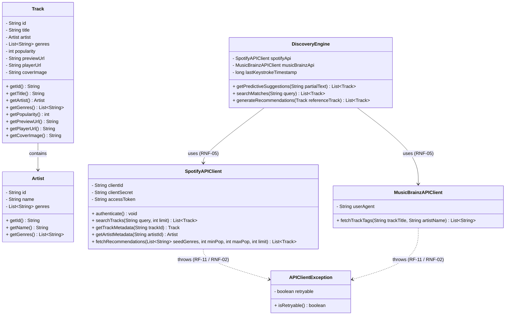

# Audy Project Documentation

## AUDY Video-Presentation

## Introduction

Audy is an online web tool designed to help users find and discover new music based on songs and artists they listen to and know they enjoy.

The user will be able to add a song as a reference, and the system will use that song to generate different suggestions for songs and artists that will suit similar tastes. Some songs will have characteristics akin to the original song, whether that is style, genre, artist or other relevant factors.

The system, however, will not be limited to only finding songs that sound alike. The inputted song will also function as a reference point to explore connections between genres, subgenres, musical styles and more relationships that will expand and diversify the user's musical catalog.

In this way, the recommendations made by the system will start from music relatively close to the original and slowly develop to include other music that might interest the user.

The primary objective is that the user can find artists or genres that they might not have listened to before and may not be able to find with a traditional search.

Unlike conventional systems that will give generic, obsolete, or repetitive suggestions, our system prioritizes the exploration and discovery of new and enjoyable music.

The system will try to avoid recommendations that are too mainstream or based solely on popularity, without reaching the point of suggesting artists with a nonexistent listening audience.

Therefore, the purpose of AUDY will be to ultimately help the user discover songs that match their affinity the most in a progressive and effective manner.

## Primary Objective

Develop a tool for music discovery that allows usage of a song known and liked by the user as a reference for obtaining recommendations for not just similar songs, but also genres, subgenres, artists and other suggestions that the user might enjoy.

This is done with the main objective of providing the user with a way to explore the music space in a way that they might not otherwise be able to.

## Functional Requirements (Second Delivery Update)

### RF-01: Search for a song
The system must allow the user to type the name of a song in a search field (Priority: High).

### RF-02: Predictive search suggestions
The system must display predictive song suggestions while the user types by querying the Spotify API with partial text (Priority: Low).

### RF-03: Search execution on Enter
The system must search the Spotify API upon pressing Enter and display a list of matches (Priority: High).

### RF-04: Reference track selection
The system must allow the user to select a reference song, either from predictive suggestions or from the match list (Priority: High).

### RF-05: Song metadata retrieval
The system must receive the metadata of the selected reference song, including its popularity score (Priority: High).

### RF-06: Artist metadata acquisition
The system must acquire the metadata of the artist of the reference song (Priority: High).

### RF-07: Smart filtering (Genres & Popularity)
The system must generate a filter using the artist's genres, track genres, and the track's popularity to find similar songs (Priority: High).

### RF-08: Return recommendations
The system must display the generated list of similar recommendations (Priority: High).

### RF-09: Recommendation details
The system must display details of the chosen recommendation: metadata and an external player link if available (Priority: Medium).

### RF-10: Null or empty results handling
The system must notify when there are no suggestions, matches, or recommendations, allowing the user to return home (Priority: Medium).

### RF-11: Error handling and recovery
The system must notify when an error occurs at any step and allow retrying or returning home (Priority: High).

## Non-Functional Requirements (RNF)

### RNF-01: Response time thresholds
Predictive suggestions appear in $\le 1\text{ s}$ and recommendations in $\le 5\text{ s}$ under normal connections (Priority: High).

### RNF-02: Fault tolerance
If an API fails or internet connection is lost, the system does not crash and displays a message allowing the user to retry or return home (Priority: High).

### RNF-03: Quality of results
The recommendation list must not show the reference song, must not show duplicate songs, and must show at least 10 results when available (Priority: High).

### RNF-04: Predictive debounce
The predictive search waits $\ge 300\text{ ms}$ after the last keystroke before querying and respects API rate limits (Priority: Medium).

### RNF-05: Modular API architecture
Access to each external API is isolated within its own dedicated class or module (Priority: High).

## Preliminary System Flow

The following diagram represents a preliminary version of how the system is expected to operate. The specific details of the process may change during the development phase.

## Technical Architecture & Filter Thresholds

1. **Modular API Architecture (RNF-05):** External services are isolated inside dedicated classes (`SpotifyAPIClient` for core catalog/recommendations; `MusicBrainzAPIClient` as a secondary tag/subgenre enrichment fallback).
2. **Adaptive Popularity Filter Thresholds (RF-07):**
   - **Mainstream Reference ($\text{Popularity} > 70$):** Target range $[25, 65]$ to avoid overly commercial hits.
   - **Mid-Tier Reference ($30 \le \text{Popularity} \le 70$):** Target range $[\max(15, P - 20), \min(75, P + 15)]$.
   - **Underground Reference ($\text{Popularity} < 30$):** Target range $[10, 50]$ to ensure active listeners.

## UML Class Diagram

The following diagram illustrates the updated class structures and relationships for the second delivery, incorporating modular APIs, error handling, and extended requirements.

# Matriz de Trazabilidad: Requisitos vs Diseño

## Requerimientos Funcionales

| Requerimiento | Componentes | Cobertura | Estado |
| :--- | :--- | :--- | :--- |
| **RF-01** | Ninguno | Sin cobertura | Pendiente UI |
| **RF-02** | DiscoveryEngine, SpotifyAPIClient | Backend | En desarrollo |
| **RF-03** | DiscoveryEngine, SpotifyAPIClient | Backend | En desarrollo |
| **RF-04** | Track | Parcial | Pendiente UI |
| **RF-05** | Track, SpotifyAPIClient | Cubierta | En desarrollo |
| **RF-06** | Artist, SpotifyAPIClient | Cubierta | En desarrollo |
| **RF-07** | DiscoveryEngine, SpotifyAPIClient | Cubierta | En desarrollo |
| **RF-08** | Ninguno | Sin cobertura | Pendiente UI |
| **RF-09** | Track | Parcial | Pendiente UI |
| **RF-10** | Ninguno | Sin cobertura | Pendiente UI |
| **RF-11** | APIClientException | Parcial | Pendiente UI |

## Requerimientos No Funcionales

| Requerimiento | Componentes | Cobertura | Estado |
| :--- | :--- | :--- | :--- |
| **RNF-01** | Ninguno | Sin cobertura | Pruebas |
| **RNF-02** | APIClientException | Parcial | Pendiente UI |
| **RNF-03** | DiscoveryEngine | Backend | En desarrollo |
| **RNF-04** | DiscoveryEngine | Cubierta | En desarrollo |
| **RNF-05** | Clases APIClient | Cubierta | Implementado |

## Explicaciones y análisis de los Requerimientos cubiertos

### Requerimientos cubiertos por el backend
Los requerimientos de obtención de datos (RF-05, RF-06) se atienden mediante las propiedades de `Track` y `Artist` junto con las llamadas en `SpotifyAPIClient`. La lógica de búsqueda predictiva y filtrado (RF-02, RF-03, RF-07) recae en los métodos de `DiscoveryEngine`. El RNF-04 está garantizado por el atributo `lastKeystrokeTimestamp` que controla el tiempo de tipeo, y el RNF-05 se cumple al modularizar los clientes en `SpotifyAPIClient` y `MusicBrainzAPIClient`.

### Requerimientos con cobertura parcial
El modelo de datos soporta el RF-04 y RF-09 almacenando la información necesaria en la clase `Track` (como `previewUrl` y `playerUrl`), pero falta la capa de presentación. De igual forma, los errores de conexión (RF-11, RNF-02) son atrapados lógicamente por `APIClientException`, pero carecen de un controlador que muestre las alertas al usuario. El RNF-03 requerirá validaciones específicas dentro de `generateRecommendations` que no se reflejan directamente como atributos estructurales.

### Requerimientos sin cobertura
El diseño actual omite por completo los componentes visuales e interactivos. El RF-01 (campo de búsqueda), RF-08 (mostrar lista de recomendaciones) y RF-10 (avisos de resultados vacíos y retorno al inicio) no tienen clases asignadas en el patrón MVC. El RNF-01 sobre tiempos de respuesta dependerá de la implementación de red y no se modela en el UML estático.
