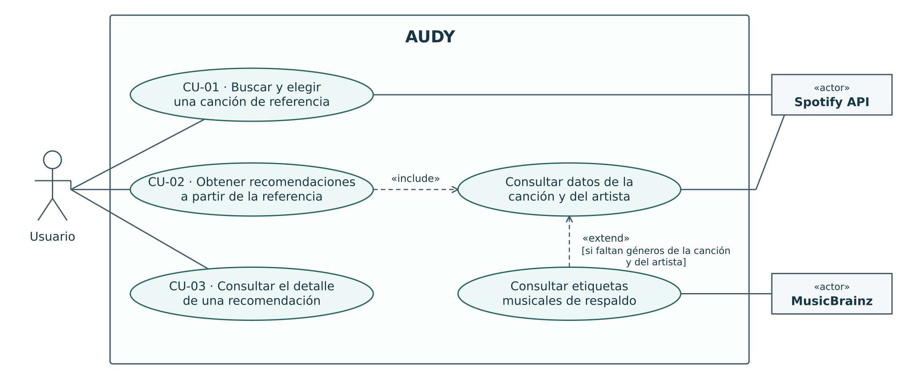

# Casos de uso de AUDY

## Recorridos y excepciones

| Caso de uso | Recorrido con el ejemplo «Tarot» | Alternativas y excepciones |
| --- | --- | --- |
| **CU-01 · Buscar y elegir una canción de referencia** | El usuario escribe «Tarot». Si elige una sugerencia del *predict*, esa canción queda como referencia y comienza CU-02. Si presiona Enter, AUDY busca coincidencias y muestra la lista. CU-02 comienza cuando el usuario elige una canción de esa lista. | Si la consulta termina sin sugerencias o coincidencias, AUDY lo indica y permite volver al inicio. Si falla el *predict*, el aviso aparece en el desplegable. Ante un error, el usuario puede reintentar con el mismo texto o regresar al inicio. |
| **CU-02 · Obtener recomendaciones a partir de la referencia** | Con la referencia seleccionada, AUDY obtiene los datos de la canción y del artista. Si faltan los géneros de ambos, consulta etiquetas de respaldo en MusicBrainz. El algoritmo de AUDY usa los géneros y la popularidad de la referencia para encontrar canciones similares. El usuario ve las recomendaciones junto a la referencia. | Si la consulta termina correctamente pero no hay recomendaciones, AUDY lo indica y permite volver al inicio. Si la consulta falla, el usuario puede reintentar con la misma referencia o regresar al inicio. |
| **CU-03 · Consultar el detalle de una recomendación** | El usuario elige una canción de la lista de recomendaciones. AUDY muestra sus metadatos y, si hay un enlace disponible, el usuario puede abrir el reproductor externo. | Si falta el enlace, los metadatos siguen disponibles. Si falla la carga del detalle, el usuario puede reintentar con la misma recomendación o regresar al inicio. |
